# TensorPEFT: fine-tuning a language model with a few thousand parameters

*Tensor gradient-pursuit adapters, explained with pictures*

Fine-tuning a large language model normally means changing millions of numbers. Parameter-efficient fine-tuning (PEFT) changes only a small, carefully chosen set. LoRA is the best-known PEFT method. TensorPEFT is a new one, built for the regime where the budget is tiny: a few thousand trainable parameters for a model with hundreds of millions.

In that regime, TensorPEFT was the best method, or tied for best, against everything we compared it with: LoRA, QLoRA, VeRA, (IA)³, prompt tuning, LayerNorm tuning and BitFit.

* **Try it live:** [huggingface.co/spaces/Angshul/TensorPEFT](https://huggingface.co/spaces/Angshul/TensorPEFT)
* **Install it:** [huggingface.co/Angshul/TensorPEFT](https://huggingface.co/Angshul/TensorPEFT)

## The idea in one picture

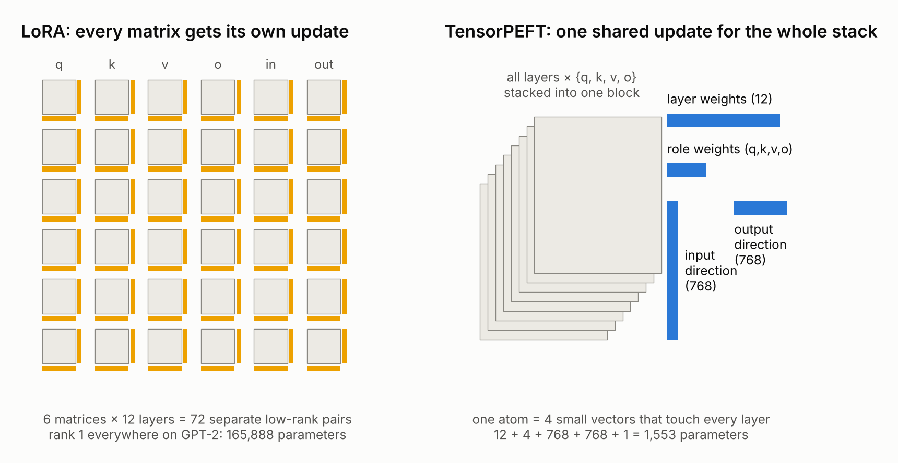

A transformer is a tall stack of layers. Each layer contains the same kinds of weight matrices: the attention projections q, k, v and o, and two MLP matrices. LoRA adapts each matrix separately, with its own small pair of factors. On GPT-2 that is 72 separate updates, and even the smallest version (rank 1 everywhere) costs about 166,000 parameters.

TensorPEFT starts from a different observation: those matrices are not independent. Matrix q of layer 3 and matrix q of layer 9 do the same job in different places. So instead of adapting them one by one, TensorPEFT stacks all matrices of the same shape into a single block and learns updates for the block as a whole.

## Stacking the network

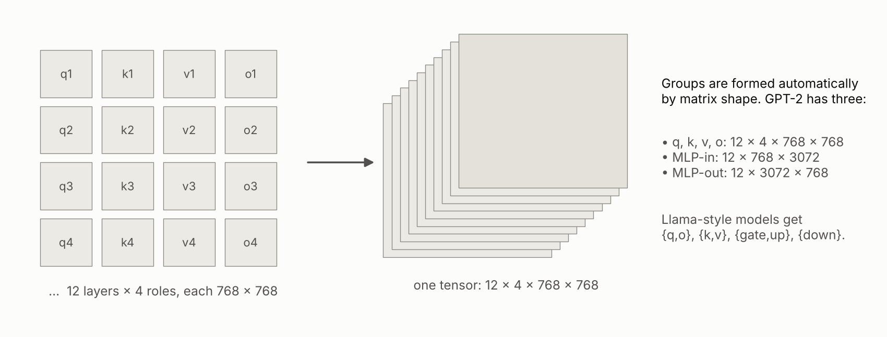

For GPT-2, the twelve layers' q, k, v and o matrices form one block of size 12 × 4 × 768 × 768. The MLP matrices form two more blocks. This happens automatically: TensorPEFT groups matrices by shape, so it works the same way on Llama, Qwen, Mistral, Phi, Gemma and other models.

## Atoms: four small vectors that reach every layer

The update to each block is built from **atoms**. An atom is four small vectors:

* a **layer** vector (12 numbers): how strongly each layer is changed,
* a **role** vector (4 numbers): how much of the change goes to q, k, v and o,
* an **input direction** (768 numbers): what the change listens to,
* an **output direction** (768 numbers): what it writes back.

Multiplied together, these four vectors describe a change to every matrix in the block at once. One atom costs 12 + 4 + 768 + 768 + 1 = 1,553 parameters, about a hundredth of the smallest LoRA.

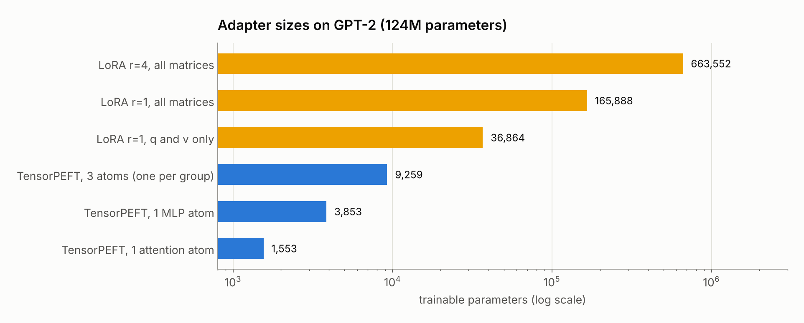

## Where do the atoms come from?

The atoms are not random. Before training, TensorPEFT runs **one gradient probe**: a single backward pass on a few batches of your data. The gradient says, for every weight in the network, which way the loss wants it to move. TensorPEFT finds the atoms that point most steeply downhill across the whole stacked block. This is the "gradient pursuit" in the name.

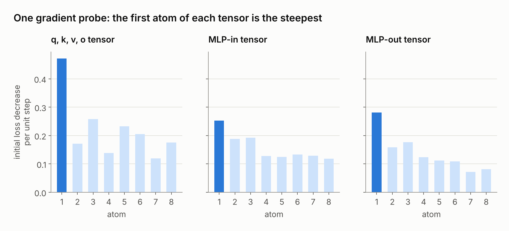

The first atom of each block is clearly the steepest, and in the attention block it is almost twice as steep as any other. That is why a handful of atoms is enough. The atoms start with a weight of zero, so the model is exactly unchanged when training begins, and every atom starts out pointing in a useful direction.

## The workflow is the same as LoRA, plus one step

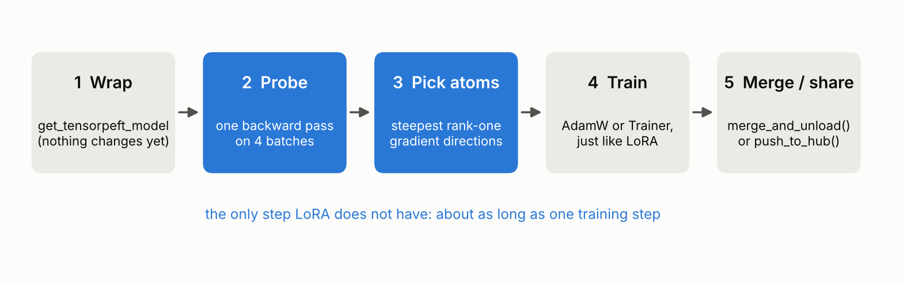

After the probe, training is completely ordinary. Any optimiser works, as does the Hugging Face Trainer. When training ends, the adapter can be merged into the model, so inference costs nothing extra. Alternatively, it can be shared as a file of tens to a few hundred kilobytes.

```python
from transformers import AutoModelForCausalLM
from tensorpeft import TensorPEFTConfig, get_tensorpeft_model

model = AutoModelForCausalLM.from_pretrained("gpt2")
model = get_tensorpeft_model(model, TensorPEFTConfig(atoms_per_group=1))
model.init_atoms(train_dataloader)      # the one extra step
model.print_trainable_parameters()      # 9,259 trainable parameters

# ... train as usual (AdamW, learning rate 3e-3) ...

model.save_pretrained("my-adapter")     # or model.push_to_hub("you/my-adapter")
model = model.merge_and_unload()        # a plain model again
```

## The test: teach English GPT-2 to write Bengali

To compare methods fairly, we took GPT-2 (124 million parameters, trained almost only on English) and fine-tuned it on three million tokens of Bengali news. Every method saw exactly the same batches for the same 300 training steps. At each budget, every method had the same number of trainable parameters. The score is the validation loss on held-out articles; lower is better.

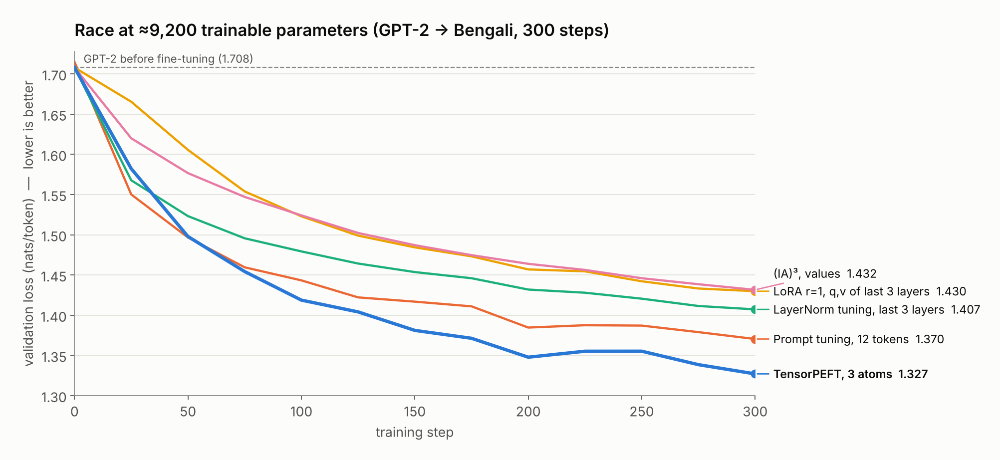

At about 9,200 parameters, TensorPEFT starts slowly, because its atoms start at zero weight. Then it overtakes every other method and finishes clearly ahead. You can rerun this race yourself in the [live demo](https://huggingface.co/spaces/Angshul/TensorPEFT). It takes about a minute on a GPU.

## Every method at every budget

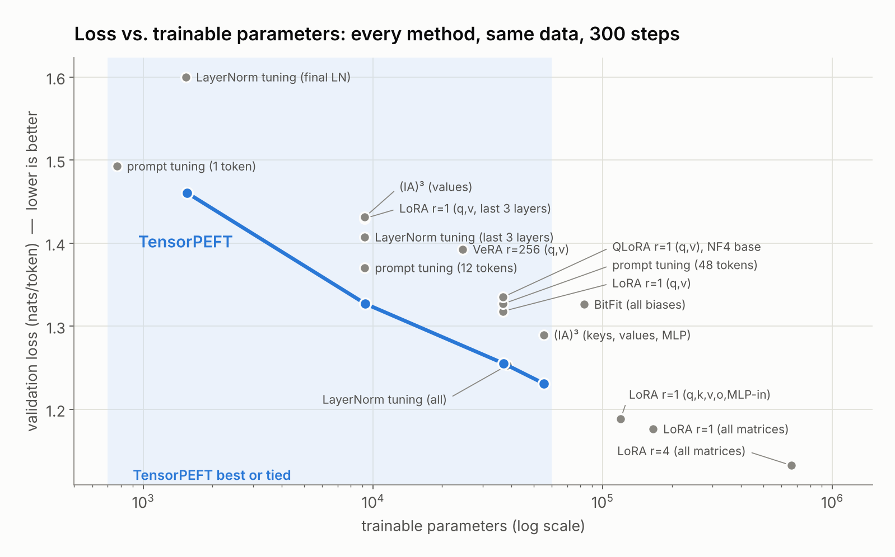

Each grey dot is a different PEFT method; the blue line is TensorPEFT. Inside the shaded region, from about 1,500 to 55,000 parameters, TensorPEFT is the best method or tied for best. The smallest standard LoRA setting (rank 1 on q and v in every layer) already needs 37,000 parameters. Going smaller means dropping layers, which is what the 9,000-parameter LoRA in our test had to do. TensorPEFT works with a single atom.

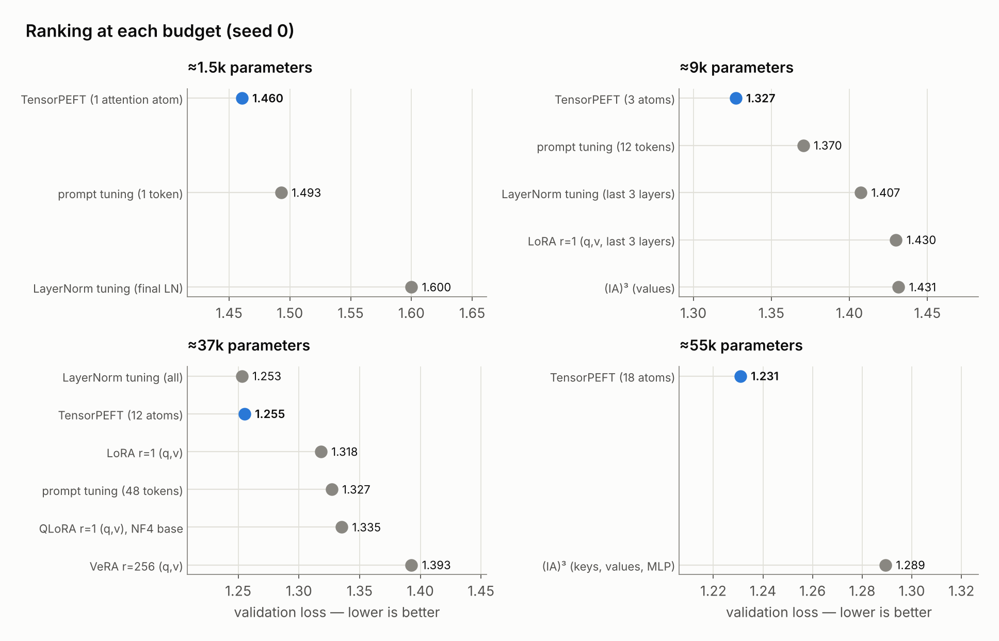

## Is it luck? Three random seeds

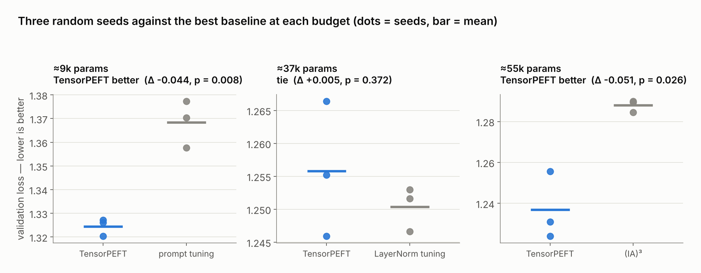

We repeated the closest contests with three random seeds.

* **About 9,000 parameters:** TensorPEFT beat prompt tuning, the best alternative, on all three seeds.
* **About 55,000 parameters:** TensorPEFT beat (IA)³ on all three seeds.
* **About 37,000 parameters:** TensorPEFT and LayerNorm tuning were statistically tied.

## One lesson: choose all atoms up front

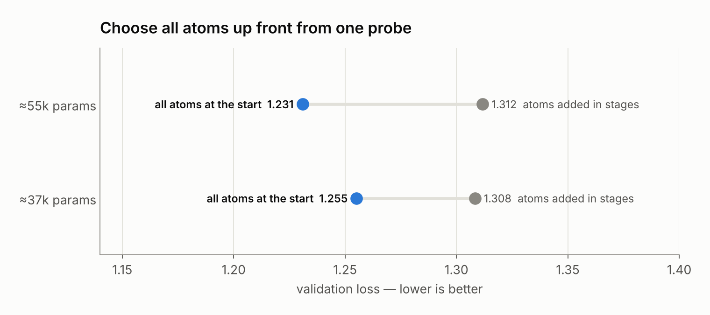

An early version added atoms in stages during training. Choosing all of them from the first gradient probe, and then training them together, was clearly better. The package does this by default.

## What did the model learn?

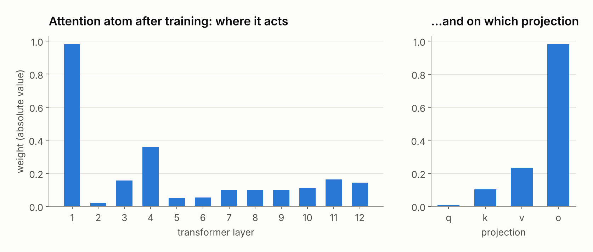

Because an atom is just four small vectors, it can be read directly. After training on Bengali, the attention atom put almost all of its weight on the first layer and on the output projection o, with smaller contributions spread over later layers. Plausibly, adapting to a new script starts close to the input. LoRA's 72 separate updates are much harder to read this way.

## When to use TensorPEFT

TensorPEFT is designed for very small budgets: many adapters per user or task, edge devices, or experiments where every trainable parameter counts. In our tests, once the budget reached about 115,000 parameters or more, LoRA was better. In that regime, use LoRA.

The evidence so far comes from one base model (GPT-2), one task (adapting to Bengali) and short training runs. Results on other models and tasks will be added as they become available.

## Try it

* **Live demo:** [huggingface.co/spaces/Angshul/TensorPEFT](https://huggingface.co/spaces/Angshul/TensorPEFT). Race TensorPEFT against the other methods and compare generated Bengali text.
* **Package:** [huggingface.co/Angshul/TensorPEFT](https://huggingface.co/Angshul/TensorPEFT)

```
pip install git+https://huggingface.co/Angshul/TensorPEFT
```

*Angshul Majumdar, IIIT Delhi*
